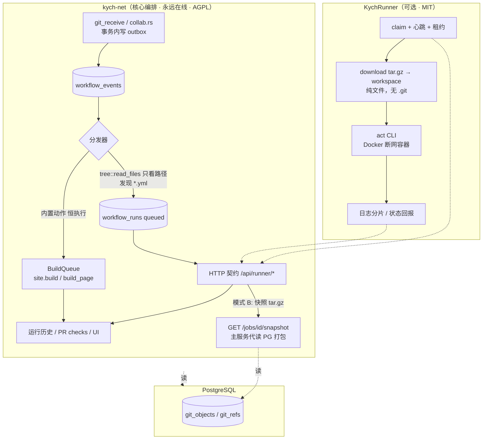

# 站内 Git 项目工作流 · 具体方案 v5（只做模式 B）

> **v5 变更**：删掉模式 A（KychRunner 直连 PG 只读视图）、`SNAPSHOT_SOURCE=auto`、
> `pg-direct` feature、`KYCHNET_PG_DSN`、只读角色与 `runner_*` 视图。
> **唯一的快照来源**：主服务 `kych-net` 代读 PostgreSQL 里的 Git 对象，打包成 tar.gz，
> 经 `GET /api/runner/jobs/{id}/snapshot` 下发给执行器。执行器零数据库凭据。
>
> 保留决策：不 clone、不 `git init`、工作区无 `.git`；执行器是独立二进制仓库
> [`kych-net/KychRunner`](https://github.com/kych-net/KychRunner)（MIT）、可选安装 / 可临时禁用；
> 工作流语法对齐 GitHub Actions（默认 `.网站名称/工作流/`）。

## 0. 决策摘要

| 项 | 定案 |
| --- | --- |
| 进程边界 | 两层：`kych-net`（核心编排，永远在线，AGPL） + `KychRunner`（可选执行器，独立 Rust 二进制，MIT） |
| Git 仓库读取 | **只走主服务接口**：`kych-net` 读 PG `git_objects`，打包 tar.gz 下发；执行器不连 PG、不 clone、不建 `.git` |
| 执行器凭据 | **仅 runner token**，零 DB 凭据；PG 完全不暴露，撤销 token 即禁用 |
| 内置动作 | `site.build` / `build_page` 不经执行器，主服务自己排队。**没装 KychRunner 时网站照常重建** |
| 状态通道 | HTTP `/api/runner/*`（runner token）+ 租约；执行器不写生产库 |
| 工作流目录 | 默认 `.网站名称/工作流/`；项目级 `workflow_dir` 可覆盖 |
| 语法执行 | KychRunner 内调 `nektos/act`；主服务不解析 YAML、不装 Docker、不依赖 act |
| 执行器缺席 | 内置动作照跑；YAML 工作流记 `skipped / no_runner`，UI 明示，TTL 内可重放 |
| 许可隔离 | KychRunner(MIT) 不拷贝 KychNet(AGPL-3.0) 源码；两仓只通过 HTTP 契约交互 |

完整契约见 KychRunner 仓库的 `docs/protocol.md`；本仓实现见 `src/workflow/runner_api.rs` 与 `src/workflow/snapshot.rs`。

## 1. 两层架构



**为什么可行**：`git_objects.data` 存的是未压缩对象原文，`tree::read_files()` 已能把某个 commit
还原成 `BTreeMap<路径, 字节>`。模式 B 只是把这份「读出来的文件」由主服务打包后 HTTP 下发，
执行器拿到的是同一份内容，无需 `.git`、无需 git 二进制、无需重建对象库。

## 2. 执行器可选性

| 状态 | 触发 | 行为 |
| --- | --- | --- |
| 未安装 | 无 `workflow_runners` 记录，或 `last_seen_at` 超时 | `executor_available=false`；新 run 直接 `skipped / no_runner`；不阻塞 push；内置动作照常 |
| 临时禁用 | `enabled=false` / 撤销 token / 项目级 `workflow_executor_enabled=false` | 同上；已 `queued` run 保留到 `expires_at`，恢复后可重放 |
| 安装并启用 | 有存活 runner 且 `protocol_version` 兼容 | `queued → claimed → in_progress`（带租约） |
| 心跳超时 | `lease_until < now()` | 打回 `queued`，`attempt+1`；超过 3 次标 `cancelled / runner_lost` |
| 队列积压 | `queued` > `WORKFLOW_QUEUE_MAX`（500）或事件超过 TTL(24h) | 最老事件标 `expired` + 告警 |
| 快照不可用 | 对象被 gc / 主服务忙 | `failure / snapshot_unavailable`，**不影响内置动作** |

UI 必须区分 `skipped / no_runner`、`skipped / disabled`、`expired`、`failure`——否则
「没装执行器」会被误读成工作流失败（GitHub Checks 里 skipped 与 failure 也是分开的）。

## 3. 契约要点

| 方法 | 路径 | 说明 |
| --- | --- | --- |
| `POST` | `/api/runner/register` | admin 用一次性注册码换 `{runner_id, token}`（仅回显一次） |
| `GET` | `/api/runner/jobs/claim` | 长轮询（30s）领 `queued` run；无 job 返回 204 |
| `GET` | `/api/runner/jobs/{id}/snapshot?kind=both` | **模式 B 快照**，tar.gz |
| `POST` | `/api/runner/jobs/{id}/start` | 回报工作流路径与 job 列表 |
| `POST` | `/api/runner/jobs/{id}/logs` | 追加日志分片 |
| `POST` | `/api/runner/jobs/{id}/steps` | 批量回报 job/step 状态 |
| `POST` | `/api/runner/jobs/{id}/complete` | `conclusion` + `exit_code` |
| `POST` | `/api/runner/heartbeat` | 续租 + `act_version` / `protocol_version` / `snapshot_source` |

认证：`workflow_runners.token_hash`（SHA-256）。所有回报带 `run_id + attempt`，服务端幂等校验，
防止租约超时后旧 runner 覆盖新 attempt。租约 5 分钟，心跳 60 秒。

### 3.1 快照格式与越权校验

tar 布局（`src/workflow/snapshot.rs` 生成，`KychRunner/src/snapshot.rs` 解包）：

```
code/<仓库内相对路径>      完整代码快照，来自 commit_oid
definitions/<文件名>       默认分支 workflow_dir 下的 *.yml|*.yaml，来自 def_commit_oid
```

响应头：`X-Snapshot-Commit` / `X-Snapshot-Def-Commit` / `X-Snapshot-Files` / `X-Snapshot-Bytes`。

**服务端校验（零新表、零签名密钥），任一不满足 403**：

1. runner token 有效且 `enabled=true`；
2. `workflow_runs.executor_id == 当前 runner.id`；
3. `status='in_progress'` 且 `lease_until > now()`；
4. 请求的 commit 属于该 run。

实现要点：

- 复用 `tree::read_files()`，按 `workflow_dir` 过滤 definitions；路径段二次校验。
- **零新增依赖**：项目已有 `flate2`，USTAR 头手写约 60 行即可，不引入 `tar` crate。
- **LFS 还原**：主服务读 `LFS_ROOT/<project_id>/<oid[..2]>/<oid[2..4]>/<oid>`，打包时把 pointer
  换成真实字节；缺失明确回报 `lfs_unavailable`。执行器不需要挂载 `LFS_ROOT`。
- **内容寻址缓存**：Git 对象不可变，`(project_id, commit_oid, def_commit_oid)` → tar.gz 长期复用。
- 当前实现为「限额内打包到内存再返回」，`max_snapshot_bytes` 默认 200MB；若仓库很大可改为
  落盘缓存 + 流式响应（需要 `tokio-util` / `async-stream`）。
- 不新增对外 API：端点只在 `/api/runner/*` 下，只认 runner token；管理端仍走 session 认证。

### 3.2 claim 关键字段

`commit_oid` = 代码快照（事件对应 commit；PR 事件为来源分支头）；
`def_commit_oid` = 定义快照（**恒为默认分支 head**），工作流 YAML 只从这里读，PR 分支里改工作流不生效。
**没有 `repo_url`、没有 `git_token`、没有 `pg_dsn`**。

## 4. 工作流语义对齐 GitHub

| GitHub 概念 | 站内实现 |
| --- | --- |
| `.网站名称/工作流/*.yml` | 默认目录；项目级 `workflow_dir` 可覆盖 |
| `on: push / pull_request / workflow_dispatch / schedule` | 主服务发事件 |
| `jobs / steps / needs / if / env / matrix` | act 解析执行，主服务不碰 YAML |
| `github.*` / `GITHUB_*` | act 原生提供；`event.json` 另注入 `kychnet` 私有节点 |
| `concurrency: group` | `workflow_events.dedupe_key` 折叠连续 push |
| Checks / required checks | `pr_checks` + `merge_pr` 门禁 |
| `queued / in_progress / success / failure / cancelled / skipped` | `workflow_runs.status` 用同一套词 |
| `permissions:` | 主服务按 `trust_level` 强制，**不信任 YAML 自声明** |

**工作区无 `.git`**：`actions/checkout@v4` 由 `--local-repository` 映射为 no-op（代码已铺好）；
工作流里不能用 `git log` / `git diff` / `git rev-parse`。提交元数据改用注入的
`KYCHNET_COMMIT_OID` / `KYCHNET_REF` / `KYCHNET_PR_NUMBER` / `KYCHNET_TRUST_LEVEL` 与 `event.json`。
这是与 GitHub Actions 唯一显著语义差异。

## 5. 数据模型

见 `migrations/0013_workflows.sql`。表：`workflow_runners`、`project_workflows`（新增路径默认关闭）、
`workflow_events`（outbox + dedupe_key + expires_at）、`workflow_runs`（executor_id / lease_until /
attempt / skipped_reason / expires_at）、`workflow_steps`、`pr_checks`。

`projects` 增加：`require_workflow_checks`、`require_executor_for_merge`、`workflow_dir`、
`workflow_executor_enabled`、`publish_on_check_success`。

**入队（与 refs 更新同事务）**：`INSERT ... ON CONFLICT (dedupe_key) WHERE status='queued'
DO UPDATE SET after_oid = EXCLUDED.after_oid ...`。一条语句同时满足「执行器缺席时事件不丢」与
「连续 push 不静默丢更新」。

**合并门禁**（`collab.rs::merge_pr`）：只认与当前来源分支 head 一致且 `required` 的 check。
执行器缺席时不写 `required` check（或写 `skipped` 且 `required=false`），避免「没装执行器就永远不能合并 PR」。

## 6. 安全边界

| 威胁 | 措施 |
| --- | --- |
| push 权限升级为 RCE | 定义只从 `def_commit_oid` 读；新路径需管理员启用；PR 工作流 `trust_level='pr'`，无 secrets、不得发布 |
| 执行器窃取/改写生产库 | **零 DB 凭据**，写状态一律走 HTTP 由主服务落库；不创建只读角色/视图 |
| 快照接口越权 | 校验 token + `executor_id` 归属 + `in_progress` + 租约有效 + commit 属于该 run；不满足 403 |
| 恶意 Git 对象 / 路径穿越 | 主服务端与执行器端双重路径段校验；`canonicalize`；拒绝 `.git` / 符号链接 / 非普通文件；字节/条目/深度限额 |
| 容器逃逸 | 禁 Docker socket、断网、`--cap-drop=ALL`、`no-new-privileges`、CPU/内存/pids 限额 |
| 容器读到 `.env` / 凭据 | 显式 `--env-file` 白名单；`GITHUB_TOKEN=` 置空；工作区只放快照文件 |
| 日志泄露 secrets | 执行器按 secrets 键值二次打码后回报 |
| 队列无限堆积 | TTL 24h + queued 上限 + dedupe 折叠 |
| 许可证污染 | KychRunner(MIT) 不复制 KychNet(AGPL) 的 `src/git/*`；两仓只通过 HTTP 契约交互 |

**信任分级由主服务强制**：

| 触发来源 | trust_level | secrets | 内置发布 |
| --- | --- | --- | --- |
| PR opened/sync | `pr` | 无 | 否 |
| push 非默认分支 | `branch` | 无 | 否 |
| push / pr_merged 到默认分支 | `default` | 管理员配置（P2） | 是 |
| `workflow_dispatch` | `manual` | 按发起者权限 | 需 admin + step-up |

## 7. 发布动作解耦

内置 `site.build` 由主服务 `BuildQueue` 在事件提交后独立排队，**与 KychRunner 是否存在、
YAML 工作流是否成功都无关**。理由：

1. 执行器可选，不能让「没装执行器」导致静态站不重建。
2. `kych-net build` 以数据库为唯一事实源，容器内拿不到也不该拿到 `DATABASE_URL`。
3. 对齐 GitHub：check 失败不阻断 push，只有分支保护才阻止合并。

`BuildQueue` 把 300ms 窗口内的连续请求折叠成一次，worker 串行调 `BuildCtl::build_all()`。
这直接修掉现有 `git_receive` 里 `build_all()` 失败只 `warn!`、而 `BuildCtl` 单槽并发直接 `bail!`
导致的**静默丢内容更新**；同时删掉 `pr_merge` 的同步构建，PR 已合并却返回 500 的歧义也消失。

## 8. 主服务改造清单

本 PR 只新增文件（`migrations/0013_workflows.sql`、`src/workflow/*`、`docs/*`），
不改现有代码，挂接步骤见 [`workflow-integration.md`](workflow-integration.md)。

| 文件 | 改动 |
| --- | --- |
| `src/main.rs` | 加 `mod workflow;` |
| `src/api.rs` | `.with_state(state)` 后 `.nest("/api/runner", workflow::router(wf_state))`；启动 dispatcher/pruner；管理端 runs/workflows/dispatch/checks 路由 |
| `src/git/http.rs` | `ReceiveOutcome.default_branch_updated: bool` → `updates: Vec<RefUpdate>`；`receive_pack` 在 `tx.commit()` **前**调 `workflow::event::enqueue()` |
| `src/collab.rs` | `create_pr`/`merge_pr`/`close_pr` 发事件；`merge_pr` 加门禁 |
| `src/api.rs::git_receive`（约 2324 行） | 删同步 `build_all()`，改成入队 |
| `src/api.rs::pr_merge`（约 1923 行） | 删同步 `build_all()` + 加门禁 |
| `src/build.rs` | `gc` 跳过 `workflow::dispatch::pending_commits()` |
| `admin/src/views/` | 工作流列表/运行历史/日志、执行器状态、PR 检查条 |

## 9. 分阶段任务与验收

### P0（本 PR 覆盖）

- [x] `0013_workflows.sql`（只做 B，无只读角色/视图）
- [x] `src/workflow/`：outbox 去重 + 路径发现 + run 生成 + 租约/过期扫描 + gc 协调
- [x] `/api/runner/*` 契约 + **模式 B 快照端点**（tar.gz + LFS 还原 + 缓存）
- [x] `BuildQueue` 去重队列
- [x] KychRunner 独立实现（见 KychRunner 仓库）
- [ ] 挂接现有触发点（见 `workflow-integration.md`）
- [ ] 管理端 UI

**验收**

1. 拔掉执行器：push 默认分支 → 静态站正常重建、push 不被阻塞、run 记 `skipped / no_runner`、UI 明示而非失败。
2. 禁用 token → 同上；撤销 token 后**快照接口返回 403**。
3. 300ms 连推 3 次 → 只 1 次发布构建，产物是第 3 次内容。
4. `kill -9` runner → 租约到期 job 回 `queued` 被重新领取。
5. 只给 runner token、不配任何 DSN，完整跑通工作流。
6. runner 用 A 的 run_id 请求 B 的快照 → 403。
7. 主服务进程内无 Docker / act / YAML 解析依赖。

### P1

PR 检查门禁 + 合并门禁 + `workflow_dispatch` / `schedule` / `tag` + 管理端 UI + PR 分支预览构建。

### P2

secrets 加密存储与注入、`uses:` 白名单 UI、matrix/services、artifact、多 runner 标签调度。

## 10. 明确不做

- **不做模式 A**：不提供 `pg_dsn`、只读视图、直连 PostgreSQL 通道。
- 不实现 GitHub Actions 全语法 / 全 marketplace 生态；`uses:` 走离线缓存白名单。
- 不接入 `actions/runner` / GitLab Runner / Gitea `act_runner`（都是平台 agent，不是独立执行器）。
- 不部署 Forgejo/Gitea 隐藏后端。
- 不 clone、不 `git init`、不生成 `.git`、不在工作流里调用 git。
- 不在 `kych-net` 进程内执行任何工作流步骤，主服务不依赖 Docker。
- 不因执行器缺席而降级任何现有能力（尤其静态站重建）。
